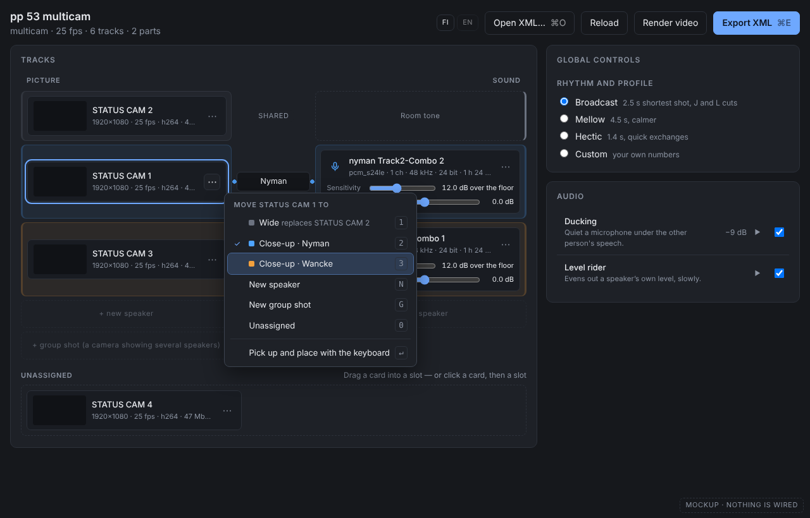
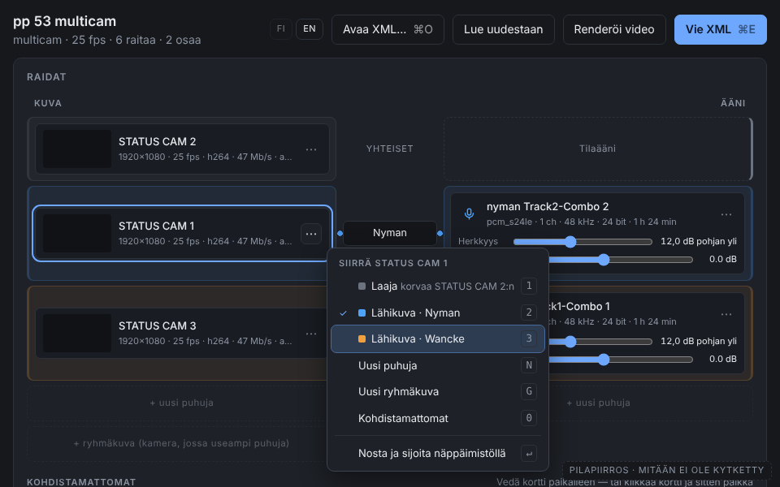
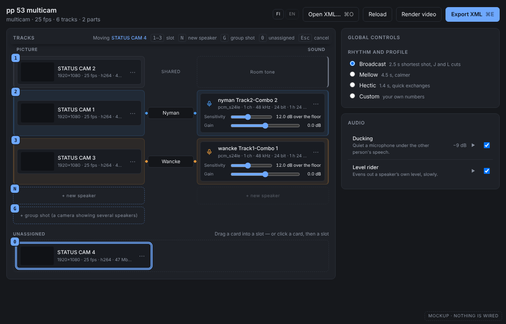
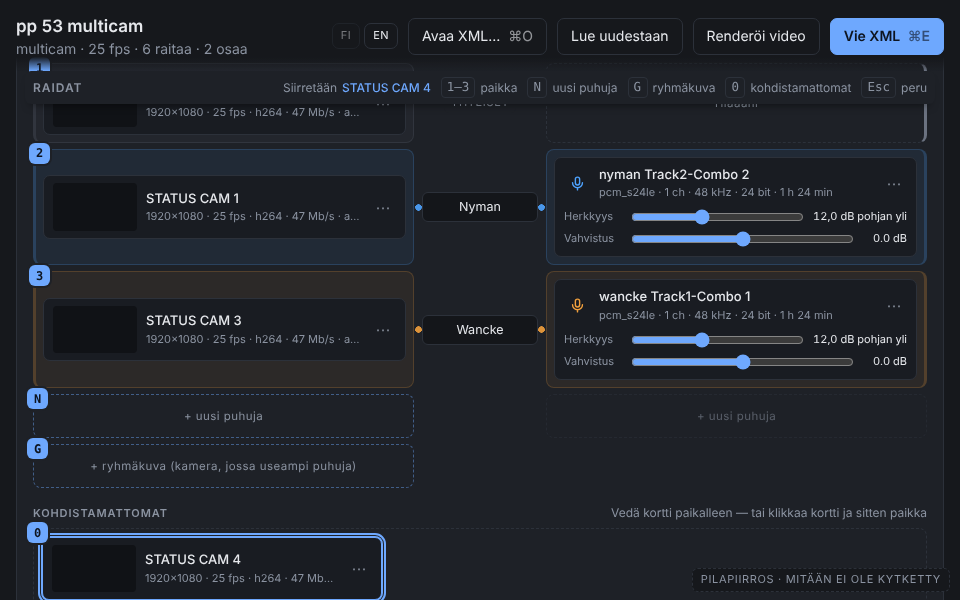
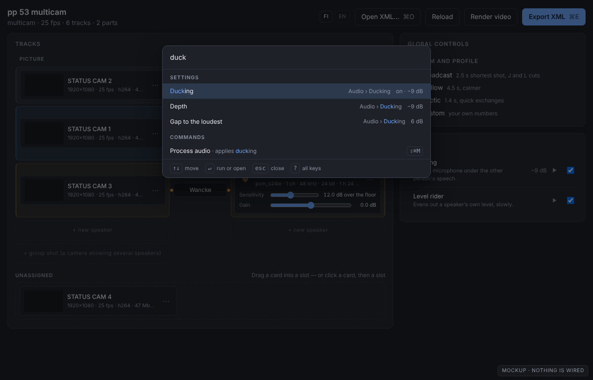
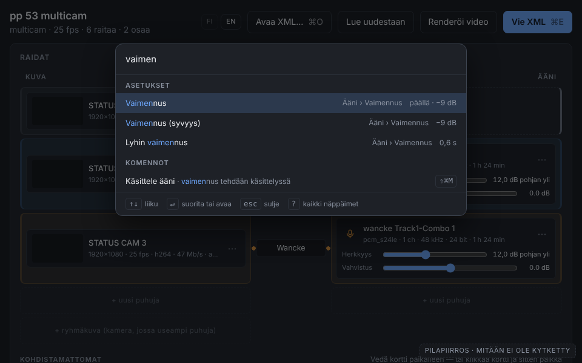

# Contextual Controls: Floating Toolbar, Context Menus, Palette

**Status (2026-10-27): revised for the shot-coverage model.** The shortcut
registry and help sheet already exist. The former keyboard-carry phase is
retired: #93 removed lifted cards, speaker slots and the patch bay. The current
controls are speaker-coverage checkboxes and a context-shot checkbox. This is a
documentation update, not a new keyboard or palette implementation.

Checked against main `6be58ad`, `server/static/app.js`, `server/CLAUDE.md` and
`tests/test_shortcuts.py`. Older screenshots and the alternatives discussion
below are historical design material; they must not be implemented as a slot
assignment workflow. No browser or assistive-technology session was run for this
revision.

**The owner's question:** "Would a Photoshop style floating toolbar be a good
idea? What about contextual menus, eg if you highlight something first and then
the relevant options pop up?" The apps target power users and keyboard
shortcuts, and "we DEFINITELY need a way to surface these features in the GUI so
that people can discover them". Scope: autoraffkat first, the other apps second.

**Builds on:** the existing `SHORTCUTS` registry, generated key hints and `?`
help sheet in `static/app.js`. New application shortcuts belong there. Native
checkbox and text-field behavior remains native.

## Decision

1. Keep controls on the object they affect. No floating palette is proposed.
2. Keep video tracks as shots with `covers` and `context`; microphone assignments
   identify speakers. A shot can cover several speakers, and a speaker can appear
   in several shots. Do not restore speaker slots or lifted-card state.
3. Coverage is currently operated with native controls: Tab/Shift+Tab to move,
   Space to toggle a checkbox, text input plus its Add control to add a speaker.
   A dedicated faster keyboard path is a new proposal, not a missing drop handler.
4. Re-evaluate card menus around current actions (coverage, context, relinking,
   microphone controls). A menu must not offer the former close/group/wide slot
   destinations. First establish that it improves on the visible controls.
5. A later palette can expose project commands and reveal existing settings.
   It must share the registry, translations and availability rules, and must not
   require a carry mode or card selection.
6. Automixer and podcast-magic proposals remain separate app work. Kuulas has
   its own active implementation and release work in a separate repository.

## What the code says: selection and actions per app

### autoraffkat

`trackCard` sets `draggable = false` and `tabIndex = -1`. There is no `picked`,
`pickUp`, `dropTarget`, `buildSlots`, `applyPicked` or `renderTray` path. The
shortcut test explicitly prohibits a card-level `keydown` handler; new global
shortcuts go through the registry. Nested text fields retain their own native
or field-specific behavior.

| Surface | Current action |
| --- | --- |
| Video-track card | Toggle the speakers visible in the shot (`covers`), add a speaker, set the preferred context shot (`context`), relink missing media |
| Microphone controls | Assign the speaker and adjust the existing audio controls |
| Preview canvas | Zoom, pan and reset the view; no selection model |
| Cut list | Inspect the generated cuts; no selectable command target |
| Header | Project commands, including registered Open/Export/help keys |
| Settings rows | Existing radios, sliders, disclosures and resets |

A card menu or a keyboard path therefore needs to act on coverage data rather
than move cards into speaker roles. The unused `patch.hint` translation is
historical residue, not evidence of a remaining patch bay.

### podcast-magic

`server/static/index.html` and `app.js` plus five `mod_*.js` modules: a left
rail with the session and the tool tabs, and one form per tool with one Run
button. There is no `keydown` listener anywhere and nothing selectable. The
only object is the session file. There are no tools and no selection; the
commands are "switch tab" and "Run".

### automixer (Textual TUI)

`src/automixer/app.py`: five `TabPane`s, `BINDINGS` for q, ctrl+s, r, f12 and
space, and a `Footer`. It contains the one real select-then-act pattern in this
repository: a `SelectionList` of audio files, then the "🎤 Speech" / "🎵 Music"
buttons apply a role to the files that are ticked (`on_button_pressed`,
app.py:416). Those two buttons have no key.

Read in the installed Textual 8.2.8 (the version in `uv.lock`), not run:

- `App.ENABLE_COMMAND_PALETTE` defaults to `True` on `ctrl+p`, so automixer
  already has a palette. Its default commands are Textual's own (Theme, Quit,
  Keys, …). `get_system_commands` is the hook for adding the app's.
- `Screen.active_bindings` walks from the focused widget outwards and the first
  binding for a key wins. `SelectionList` binds Space to "select" with
  `show=False`. So while the file list has focus, Space ticks a file and the
  Footer correctly stops advertising "Play/Stop Preview". The Footer is already
  focus-contextual.

### kuulas (read-only clone, `/home/user/ollisulopuisto/kuulas`)

A timeline editor with real selections: clips, an in/out range, transcript
words and a current track. Already in place, per `docs/KEYS.md` (generated),
`docs/PLAN.md` WP5 and WP48, `ROADMAP.md` and `docs/BUGS.md`: a command
registry with per-context keymaps, a ⌘K palette, ⇧⌘K command search that shows
where a command is in the menus, a `?` cheat sheet, F1 help, an in-window menu
bar (pywebview's native menus could not show enabled state or keys; owner,
2026-10-18), right-click menus on clips, ranges, lanes, the ruler and the
track/bus headers (`ui/context-menu.js`, `ui/timeline-menu.js`), and status-bar
key hints (`ui/hints.js`, at most three). The owner has ruled that "ALL OPTIONS
have to be found from the menus" and that every menu item shows its key, and a
`menu-coverage` test enforces the first. kuulas also has the only real *tool* in
any of these apps: the preference "Mouse: dragging paints a range / moves
clips" (BUGS #45).

## Historical alternatives (2026-10-25; former slot model)

| Option | autoraffkat | podcast-magic | automixer | kuulas (rec.) |
| --- | --- | --- | --- | --- |
| (a) Floating tool palette | **No** | No | Impossible in a TUI | No |
| (b) Contextual bar near the selection | **Docked, not floating:** the carry bar | No (nothing to select) | The Footer already is one | **Docked:** selection-aware status hints |
| (c) Context menu | **Yes, on cards** | No | No (no pointer menus; the palette covers it) | Exists; fix keyboard opening |
| (d) Command palette | **Yes, phase 3, with settings** | No | **Yes, it exists:** register commands | Exists |
| (e) Menu bar / grouped header | No; the header is the command bar | No | No | Exists |
| (f) Cheat sheet only | Not enough: it cannot place a card | **Yes** | Footer + palette | n/a |

### (a) Floating tool palette: no

- **There is nothing for it to hold.** Photoshop's Tools panel holds dozens of
  modes for one canvas. autoraffkat's actions are seven header commands, a lift
  and a place. A palette of commands is a second copy of the header, floating.
- **Screen space.** pywebview opens autoraffkat at 1280 × 820 with
  `min_size` 960 × 600 (`gui.py`). At 960 the rail already drops below the
  tracks (`style.css`: one column under 1000 px), and the header is a single
  row of six to eight buttons. A floating panel takes room from the patch bay,
  the one area the user is working in.
- **Focus and keyboard.** A floating panel is either one more tab stop the
  keyboard user walks through, or it is skipped and serves only the mouse. The
  WAI-ARIA toolbar pattern gives a toolbar "one stop" with arrow keys inside,
  which works, but it still means the user moves focus *away from the card* to
  act on it. The menu and the carry keys act from the card.
- **pywebview.** The page cannot float a panel outside its own window. A real
  utility window would be a second pywebview window with its own DOM and state,
  which is a second app.
- **Accessibility.** A movable overlay has no stable place in the reading
  order, and dragging it is mouse-only unless move keys are added for it too.

### (b) Selection-anchored contextual toolbar: yes as a docked bar, not a floating one

Photoshop's Contextual Task Bar, Figma and Google Docs float a bar next to the
selection. Adobe documents that its bar can be dragged, pinned, reset and
hidden (Photoshop Elements help, which describes the same bar). That set of
controls exists because the floating bar covers what you are editing. In
autoraffkat the "selection" is a card in transit, and what it would cover are
the slots it is about to land in. So the bar goes into a row that already
exists, the Tracks panel heading (`h2` "Tracks", left; carry keys, right), and
the slot digits go onto the slots themselves. It stays sticky under the header
while a card is carried, because at 600 px the tray is below the fold (seen in
the mockup; see "Mockups").

### (c) Context menu: yes, on cards, opened every way

NN/g's ten guidelines (read): use them for secondary actions, put the trigger
near its object, keep the icon visible "without hover", group only actions of
that object, and make them keyboard and screen-reader accessible. Guideline 8
says not to use one for one or two actions. A card has between five and twelve,
so it qualifies.

Apple's HIG (read): "Always make context menu items available in the main
interface, too", "Aim for a small number of menu items", about three groups at
most, "Hide unavailable menu items, don't dim them", submenus at most one
level, and **"Show keyboard shortcuts in your app's main menus, not in context
menus"**. This design breaks that last rule on purpose. Apple's reason is that
the menu bar already teaches the keys. autoraffkat has no menu bar and the
owner's goal is to teach the keys, so the context menu is where they are
taught. kuulas made the same call (owner, 2026-10-18).

WAI-ARIA APG, Menu and Menubar Pattern (read): focus goes to the first item on
open, Up/Down move, Enter activates and closes, Escape closes "and return[s]
focus to the element or context" that opened it, Tab closes, Home/End are
optional, and type-ahead is optional ("Move focus to the next item … whose
label begins with that printable character"). Disabled items may take focus
but not activate.

MDN on `contextmenu` (read): it fires on right-click "or by pressing the
context menu key". Shift+F10 is not mentioned, and macOS keyboards have no
Menu key, so Shift+F10 must be bound in the registry and not left to the
browser.

### (d) Command palette: yes, but third, and for settings as much as commands

autoraffkat has about eight header commands, too few to need searching. What
it has many of is **settings**: the audio panel showed 26 sliders before they
were put one disclosure away (`server/CLAUDE.md`), and `app.js` has 15
`settingRow` call sites (disclosure rows in the Cut and Audio panels) and 26
slider specs in its `*_KNOBS` tables. "Where is the ducking depth?" is the question a palette answers, by
opening the row and focusing the slider. That is the reason to build it, and
it is also why it waits for the registry: it needs settings described as data,
which the registry does not contain yet.

### (e) Menu bar: no

The header already is autoraffkat's command bar, ordered by the workflow from
left to right (open, reload, process, render, export). A menu bar would add a
row to a 600 px window to show the same eight commands. kuulas needed one
because it has over a hundred commands (`docs/KEYS.md`). Apple's toolbar
guidance ("Make every toolbar item available as a command in the menu bar")
assumes a native menu bar. pywebview's native menus cannot show enabled state
or the current key (kuulas found this), so the registry-driven palette and
cheat sheet stand in for it.

### (f) Cheat sheet only: not enough for autoraffkat, enough for podcast-magic

The cheat sheet lists keys. It cannot fix the missing keyboard path for placing
a card, and it does not answer "what can I do with *this*?" For podcast-magic,
with no selection and a handful of commands, it is the right amount.

## What to build in autoraffkat

### Coverage keyboard proposal

First check the present Tab/Space path on realistic speaker/shot counts. If a
faster route is needed, define how focus identifies a shot and which registered
commands move between its controls. Preserve checkbox focus, checked state,
accessible labels and text editing. Do not bind digits to speaker positions:
coverage is many-to-many and timeline order is not a stable speaker identifier.
A card scope would require an explicit registry and shortcut-test change in the
same implementation PR; it is not authorized by the historical carry design.

### Menus and command palette

List current actions before choosing a menu layout. Use shared command IDs,
translated labels and applicability rules for the help sheet, menu and palette.
A palette setting result reveals the existing control instead of duplicating
its state. Parameterized coverage commands, if any, use stable track/speaker
identifiers and synchronize the visible checkbox state.

### Verification required for an implementation

- Cover a shot containing two speakers and a speaker present in two shots.
- Confirm keyboard actions update the same `covers`/`context` data as pointer
  actions and preserve every unrelated selection.
- Preserve native text entry, Tab/Space checkbox behavior, focus return and Esc
  for any newly introduced menu.
- Derive command hints from the registry and verify labels in Finnish and
  English. Keep the existing UI smoke test and shortcut contract tests.
- Exercise actual browser and pywebview behavior before claiming accessibility
  or macOS keyboard compatibility. Mock DOM results alone do not establish it.

## Phased plan

Each future implementation is a separate PR; this revision only updates the
plan. The first two rows replace the old carry phase.

| Phase | State and next step | Evidence needed |
| --- | --- | --- |
| Registry/help | Already present; extend it when adding actual commands | Existing shortcut and bilingual UI smoke tests |
| Keyboard carry | Retired after #93; no implementation | No lifted-card or slot state reintroduced |
| Coverage keyboard | Optional design after checking native Tab/Space | Realistic many-to-many coverage and focus behavior |
| Card context menu | Re-scope to current actions before implementation | Shared command rules, current targets, focus return, both languages |
| Settings labels | Inspect current translated labels before changing them | No ambiguous setting results in a future palette |
| Project/settings palette | Independent of carry or card selection | Registry completeness and reveal of existing controls |
| Automixer | Separate Textual command-discovery work | Focused Textual pilot tests |
| Podcast-magic | Separate key hints/help proposal | Its own UI smoke test |

## Mockups (historical slot-model proposal)

`docs/plans/assets/contextual-controls-mockup.html` links autoraffkat's real
`style.css` by relative path, so the tokens (`--bg`, `--panel`, `--line`,
`--accent`, `--sp0…`), the header, panels, slots, cards and disclosure rows are
the shipping ones. Only the menu, carry bar and palette are new CSS, built from
the same tokens. `apps/autoraffkat/DESIGN.md` has no visual tokens; they live
in `style.css`'s `:root`. The app is dark only (no `prefers-color-scheme` in
`style.css`), so there is no light version. `?lang=en|fi&state=menu|carry|palette`
picks the view. `render-contextual-mockups.js` re-renders the six PNGs with the
preinstalled Chromium and fails if the page makes any non-file request (it
made none). The thumbnails are blank on purpose, and the key ⇧⌘M on "Process
audio" is a placeholder: only ⌘O and ⌘E exist today, and the registry branch
decides the rest.

**Nothing in these pictures is wired.**

### Context menu on a card

### Carrying a card with the keyboard

### Command palette

### What I looked at, and what changed because of it

I opened every PNG and read it. Changes made after looking:

- **Finnish menu at 960 × 600:** the first version flipped the menu above the
  card when it did not fit below. It then covered the header buttons and the
  "Nyman" strip, the row the menu is about. It now slides up only as far as it
  must. It still overlapped the strip until I removed a footer line ("Also:
  right-click · Shift+F10 · ⋯") that the `⋯` tooltip and the cheat sheet carry
  anyway. In the final image the menu starts below the strip.
- **Carry at 960 × 600:** with the lifted card in the tray, the card is below
  the fold, and the carry bar in the panel heading scrolled away with the page.
  The bar is now sticky under the header while carrying. In the final image it
  sits under the header with the card in view at the bottom. The slot "1" badge
  shows through the header's fade, as content does in the real app.
- **Palette:** the key chip "⇧⌘M" was hard to read at 11.5 px; it is 12.5 px
  now. The Finnish depth value was an invented 0.3 s; it is the real default,
  0.60 s (`speechmix.masks.DUCK_MIN_CLOSED`). −9 dB and 6 dB are `DUCK_DB` and
  `DUCK_DOMINANCE_DB`.
- **Fidelity:** in carry mode every cell that accepts the card is outlined as
  `.is-target`, as `applyPicked` does, not just the empty rows.

What I did not check: real fonts on macOS (Chromium on Linux rendered the
`-apple-system` stack with its fallback), Retina rendering, pywebview's WebKit
(the screenshots are Chromium), and screen readers. The pictures are only a
claim about layout, wording and fit at the two window sizes.

## Other apps

### automixer

The Footer is the TUI's contextual toolbar and already follows focus. What is
missing is that the app's own commands are not in the palette and the two
marking buttons have no key. Add `get_system_commands` yielding one
`SystemCommand` per `BINDINGS` action and per button action (Scan for ad break,
Render preview, Render final mix, Open plugin window, Mark as speech, Mark as
music). Bind marking on the `SelectionList` itself, so the Footer shows those
keys only when the file list has focus. Which letters to use is the owner's
call: `s` and `m` read well, and q, r and space are taken at app level.

### podcast-magic

Key hints on the tool tabs and on each Run button, and a `?` sheet. No menus.
If the autoraffkat registry ends up small and generic, it can be copied here
deliberately. Otherwise this app does not need one.

### Kuulas (recommendation; separate repository, not edited)

- **Docked selection hints instead of a floating bar.** `STATUS_HINTS` in
  `ui/keymap-default.js` is keyed by panel and capped at three
  (`ui/hints.js`, `MAX_HINTS`). With clips or a range selected in the
  timeline, the first three that apply are play, view and split, not the
  cut/delete/copy keys a selection invites. Keying the list by selection kind
  (nothing, clips, range, words, candidate) gives kuulas Photoshop's contextual
  task bar without covering the waveform.
- **Suspected: the keyboard-opened timeline menu ignores the selection.**
  `showTimelineMenu` detects a keyboard opening by `clientX === 0 &&
  clientY === 0`, and `timeline.js`'s `contextmenu` handler has already passed
  `hitAt(event)` with those coordinates. The menu is therefore built for
  whatever is under the canvas's top-left corner, and for a lane or ruler hit
  `contextPress` sets `seek` to that frame. I read this and did not run it.
- **Suspected: no Shift+F10 on macOS, and no focus return.** Nothing in
  `ui/` binds F10 (searched), and macOS keyboards have no Menu key. `close()`
  in `ui/context-menu.js` removes the menu without refocusing the opener.
- **Two menu rules disagree.** BUGS #42 says the right-click menu lists only
  what is possible for the target. `context-menu-model.js` (the header menus)
  keeps disabled items with `aria-disabled`. Apple says hide in context menus.
  Pick one.

## What is not known

| Unknown | Why it matters | Next evidence |
| --- | --- | --- |
| Whether native coverage controls are too slow | Determines whether a dedicated keyboard feature has value | Observe a real episode with several shots/speakers |
| pywebview context-menu and focus behavior on macOS | Browser mock tests cannot prove it | Interactive check when a current-model menu exists |
| Whether users need settings search | Determines the palette scope | Trial against the existing settings rows |
| Touch use | May change trigger and focus requirements | Owner workflow |
| Podcast transcription speed and timing accuracy | Separate model validation, not a controls decision | `scripts/ab/transcribe_bench.py` on real audio and hand marks |

## Sources read for this document

- Nielsen Norman Group, "Designing Effective Contextual Menus: 10 Guidelines",
  <https://www.nngroup.com/articles/contextual-menus-guidelines/>
- W3C WAI-ARIA Authoring Practices, Menu and Menubar Pattern,
  <https://www.w3.org/WAI/ARIA/apg/patterns/menubar/>, and Toolbar Pattern,
  <https://www.w3.org/WAI/ARIA/apg/patterns/toolbar/>
- Apple Human Interface Guidelines, Context menus and Toolbars, read through
  the JSON behind
  <https://developer.apple.com/design/human-interface-guidelines/context-menus>
  and <https://developer.apple.com/design/human-interface-guidelines/toolbars>
  (the HTML pages render with JavaScript)
- MDN, `Element: contextmenu event`,
  <https://developer.mozilla.org/en-US/docs/Web/API/Element/contextmenu_event>
- Adobe, Photoshop Elements help, Contextual Task Bar,
  <https://helpx.adobe.com/lt/photoshop-elements/desktop/workspace-and-environment/contextual-task-bar.html>
  (Photoshop's own help page returned 403; read through a search summary, not
  the full page)
- Textual 8.2.8 source as installed: `app.py` (`ENABLE_COMMAND_PALETTE`,
  `get_system_commands`), `screen.py` (`active_bindings`),
  `widgets/_selection_list.py`
